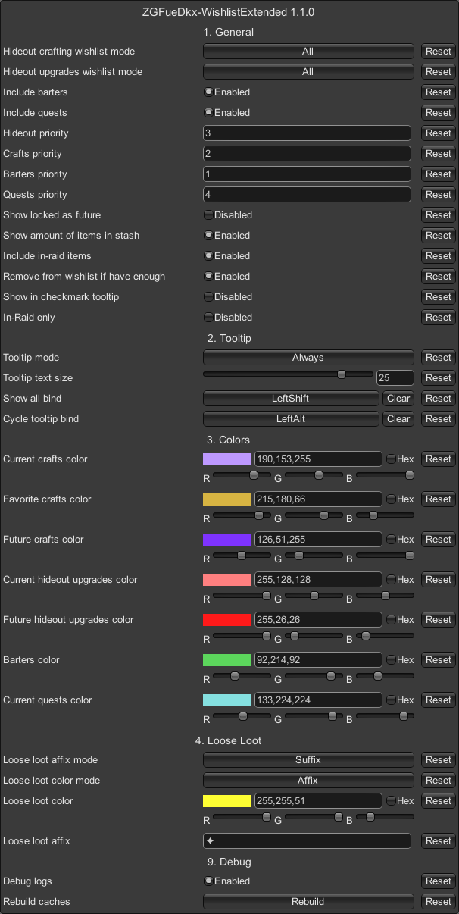

# Wishlist Extended
Wishlist Extended is a mod for SPT that expands the built-in auto-wishlist system with additional customization options.
It allows you to control which crafts and hideout upgrades are automatically wishlisted, and also adds support for automatically wishlisting items required for barters.

A more detailed description and screenshots are available on [SPT Forge](https://forge.sp-tarkov.com/mod/2500/wishlist-extended).

## Looking for translators
I'm looking for people who are willing to provide translation for this mod. If you want to contribute to this mod by traslating it, please head to the [locales](/WishlistExtendedClient/locales/) directory in `WishlistExtendedClient` and follow instructions inside `README.md` file.

## Installation
1. Make sure that both SPT Client and SPT Server are not running
2. Head to [releases page](https://github.com/danx91/WishlistExtended/releases)
3. Download correct version for your SPT
4. Open zip file
5. Drag and drop `BepInEx` and `SPT` folders to your SPT directory
6. Start server and client and make sure that mod is working

## Building from source
To build the project from source, follow these steps:
1. Clone or download this repository
```
git clone https://github.com/danx91/WishlistExtended.git
```
*(Alternatively, download the ZIP and extract it.)*

2. Download or clone the required [Common Library](https://github.com/danx91/SPT-ZGFueDkxCommonLibrary)
```
git clone https://github.com/danx91/SPT-ZGFueDkxCommonLibrary.git
```
Place it in a directory of your choice.

3. Adjust project references
Update the .csproj files to ensure that project and/or assembly references correctly point to the Common Library and SPT binaries location on your system.

4. Build the solution
Open the solution in Visual Studio and build it, or run:
```
dotnet build
```

## Config

### Client config
You can access config while in-game by pressing `F12` key and then selecting `ZGFueDkx-WishlistExtended` tab



#### General
* **Hideout crafting wishlist mode** - Specifies which crafts should be wishlisted
  * **Disabled** - don't include any crafts
  * **Favorite** - include only favorite crafts
  * **Current** - include all currently available crafts
  * **All** - include all crafts (even future ones)
* **Hideout upgrades wishlist mode** - Specifies which hideout upgrades should be wishlisted
  * **Disabled** - don't include any upgrades
  * **Current** - include all currently available upgrades
  * **All** - include all hideout upgrades (even future ones)
* **Include barters** - Whether or not to include barters. Mod must be installed on the server for barters wishlist!
* **Include quests** - Whether or not to include current quests
* **Crafts priority** - Icon priority for craftings - higher value is more important
* **Hideout priority** - Icon priority for hideout upgrades - higher value is more important
* **Barters priority** - Icon priority for barters - higher value is more important
* **Quests priority** - Icon priority for quests - higher value is more important
* **Show locked as future** - Whether locked upgrades/crafts should be listed as future instead of current
* **Show amount of items in stash** - Whether total amount of items in stash should be displayed in the tooltip
* **Include in-raid items** - Whether items in inventory should be included in amount of items in stash
* **Remove from wishlist if have enough** - Whether items should be removed from wishlist if you have enough items. If crafts or barters are enabled, item will not be removed if it's present in either of these categories
* **Show in checkmark tooltip** - Whether wishlist details should be also shown in checkmark tooltip
* **In-Raid only** - Whether the auto-generated wishlist should work only in raid. Manual wishlist will work regardless
#### Tooltips
* **Tooltip mode** - Defines the behavior of tooltip
  * **Disabled** - no wishlist details in the tooltip
  * **Always** - no binds, everything is shown
  * **Hide** - don't show anything, use 'Show all' bind to show
  * **Cycle** - only one category, use 'Cycle tooltip' bind to change, use 'Show all' bind to show all
  * **HideFuture** - hide future crafts/modules, use 'Show all' bind to show them
* **Tooltip text size** - Determines size of the tooltip text. 30 is normal, 0 is extremely small
* **Show all bind** - Shows info hidden by currently selected 'Tooltip mode'
* **Cycle tooltip bind** - When pressed, category displayed in tooltip is changed (Cycle tooltip mode only)
#### Colors
* **Current crafts color** - Color of current crafts in tooltip
* **Favorite crafts color** - Color of favorite crafts in tooltip
* **Future crafts color** - Color of future crafts in tooltip
* **Current hideout upgrades color** - Color of current hideout upgrades in tooltip
* **Future hideout upgrades color** - Color of future hideout upgrades in tooltip
* **Barters color** - Color of barters in tooltip
* **Current quests color** - Color of current quests in tooltip
#### Loose Loot
* **Loose loot affix mode** - Specifies how to add the affix to loose loot names
  * **Disabled** - do nothing
  * **Prefix** - show the affix before the item name
  * **Suffix** - show the affix after the item name
* **Loose loot color mode** - Specifies how loose loot names will be colored
  * **Disabled** - do nothing
  * **Name** - set the color of the item name
  * **Affix** - set the color of the affix
  * **Both** - set the color of both the item name and the affix
* **Loose loot color** - Color of the item name (only in Color mode)
* **Loose loot affix** - Affix to show next to the item name when enabled

## License
Copyright © 2025-2026 danx91 (aka ZGFueDkx)

This program is free software: you can redistribute it and/or modify it under the terms of the GNU General Public License as published by the Free Software Foundation, either version 3 of the License, or (at your option) any later version.

This program is distributed in the hope that it will be useful, but WITHOUT ANY WARRANTY; without even the implied warranty of MERCHANTABILITY or FITNESS FOR A PARTICULAR PURPOSE. See the GNU General Public License for more details.

You should have received a copy of the GNU General Public License along with this program. If not, see https://www.gnu.org/licenses/.

If you believe that this software infringes your or someone else's copyrights, please feel free to contact me via Discord (**danx91**) so we can try to resolve the issue amicably.